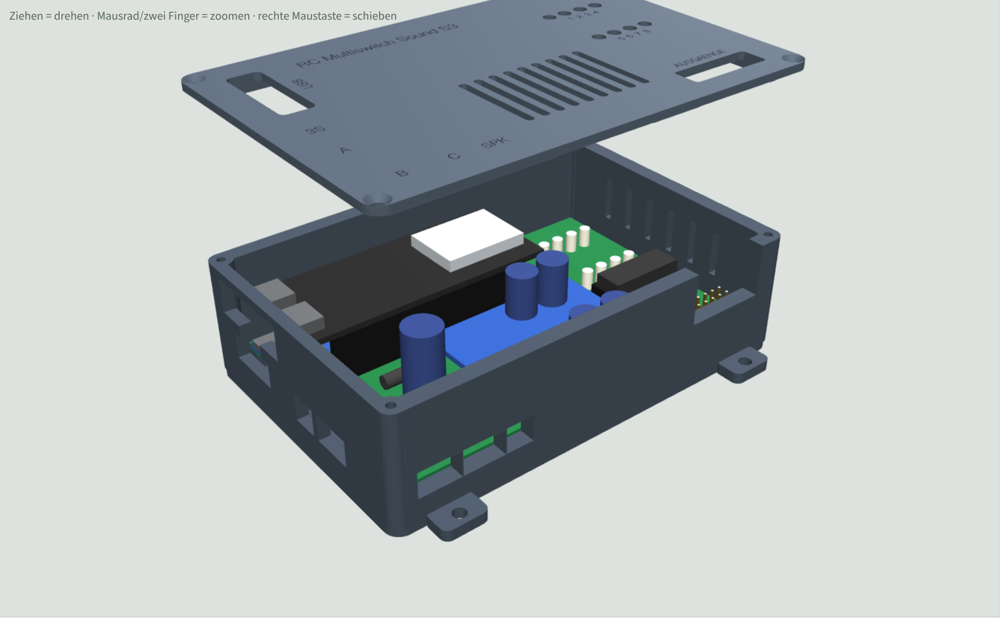
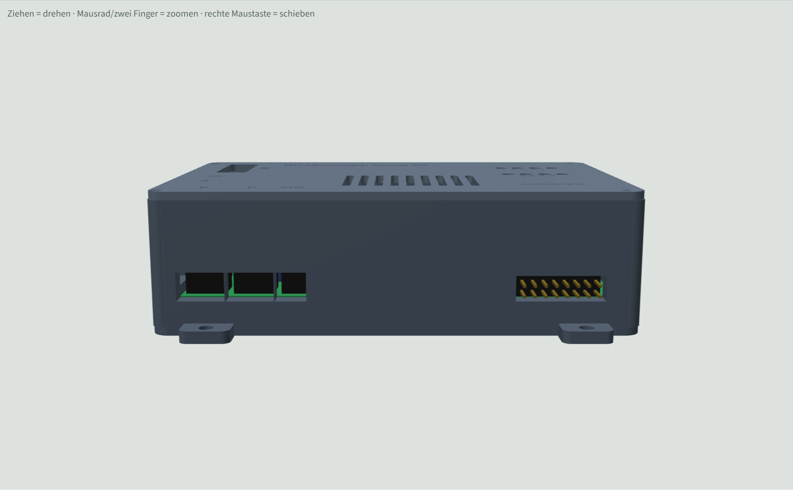

# Gehaeuse fuer RC-Multiswitch-Sound-ESP32-S3 (Platine v0.9)

3D-druckbares Gehaeuse aus Unterteil und Deckel. Die Masse stammen aus `hardware/RC-Multiswitch-Sound-ESP32-S3.kicad_pcb` (Platine 106 x 68,15 mm), die Bauteilhoehen sind Annahmen (siehe unten).



## Dateien
| Datei | Inhalt |
|---|---|
| `Gehaeuse_Unterteil.stl` | Unterteil, druckfertig (Boden aufs Bett) |
| `Gehaeuse_Deckel.stl` | Deckel, druckfertig (schon gedreht, Oberseite aufs Bett) |
| `Gehaeuse_Unterteil.step`, `Gehaeuse_Deckel.step` | zum Weiterbearbeiten in Fusion 360, FreeCAD oder KiCad (Deckel in Einbaulage) |
| `gehaeuse.py` | Quelle (CadQuery), alle Masse als Parameter oben in der Datei |
| `Gehaeuse3D_Vorschau.html` | drehbare 3D-Vorschau mit Platine (im Browser oeffnen) |

## Masse
- Aussen 117,2 x 78,2 x 34,6 mm (mit Deckel), Wand 2,2 mm, Boden und Deckel 2,0 mm.
- 5 mm Platz unter der Platine (Loetstellen), 24 mm ueber der Platine.

## Annahmen (am echten Aufbau pruefen)
- Elko C1 (470 uF/35 V) ist 22 mm hoch und steht, er ist das hoechste Teil.
- Unterkante des ESP32-S3-DevKitC-1 liegt 13 mm ueber der Platine (Buchsenleisten). Danach richtet sich der USB-Ausschnitt.
- Lage von BOOT, RESET und RGB-LED auf dem DevKitC-1 ist nicht in der KiCad-Datei, deshalb ein grosses Fenster im Deckel am USB-Ende.

## Oeffnungen
- Links: USB-C des ESP32 (beide Buchsen), microSD-Karte mit Griffmulde, CN1 UART A, CN2 Akku 3S.
- Vorne: J5 UART B, J6 UART C, CN4 Lautsprecher, Kabelschlitz fuer J1.
- Deckel: Ausschnitt ueber J1 (Ausgaenge 2x8), Fenster BOOT/RESET/RGB-LED, 8 Lichtloecher fuer die Kontroll-LEDs, Lueftungsschlitze ueber dem TPA3118, vertiefte Beschriftung.
- Rechts: 6 Lueftungsschlitze.

## Drucken und Montieren
- PETG oder ASA (der TPA3118 wird warm), 0,2 mm Schicht, 3 Wandlinien, 20 % Fuellung, keine Stuetzen noetig.
- Platine: Sie hat keine eigenen Montageloecher. 4 x M3-Schraube von oben durch die Befestigungsloecher des TPA3118-Moduls und die Platine in die Saeulen (Kernloch 2,5 mm, selbstschneidend, ca. M3 x 16-20 je nach Modulabstand). 6 Stuetzen am Rand tragen die Platine zusaetzlich.
- Deckel: 4 x Blechschraube 2,5 x 8 in die Eckdome.
- Einbau ins Modell: 4 Laschen am Boden mit 3,4-mm-Loch fuer Schrauben oder Kabelbinder.
- Die Kontroll-LEDs sitzen ca. 19 mm unter dem Deckel; wer sie direkt im Deckel haben will, loetet sie mit langen Beinen ein.

## Version mit gewinkelter Stiftleiste (J1 nach vorne)
Fuer eine gewinkelte Stiftleiste 2x8, 2,54 mm an J1 statt der stehenden. Die Stecker der 8 Ausgaenge kommen vorne durch die Wand, der Deckel ist ueber J1 geschlossen. Der hohe Kabelschlitz fuer J1 entfaellt.



| Datei | Inhalt |
|---|---|
| `Gehaeuse_Unterteil_gewinkelt.stl` / `.step` | Unterteil mit Schlitz 21,5 x 6,2 mm in der vorderen Wand |
| `Gehaeuse_Deckel_gewinkelt.stl` / `.step` | Deckel ohne J1-Ausschnitt |
| `Gehaeuse3D_Vorschau_gewinkelt.html` | 3D-Vorschau dieser Version |

- Die Leiste wird in die vorhandenen Loecher von J1 geloetet, der Kunststoffkoerper zeigt zur vorderen Platinenkante. Die Platine bleibt unveraendert.
- Masse nach KiCad-Footprint `PinHeader_2x08_P2.54mm_Horizontal`: Koerper 5,1 mm hoch, steht ca. 0,6 mm ueber die Platinenkante, die Pins ragen ca. 3,8 mm aus der Aussenwand.
- Oben liegen die Ausgaenge (ungerade Pins), unten VLOAD (gerade Pins).
- Der Schlitz passt fuer 8 Dupont-Stecker 2-polig nebeneinander (je 2,54 x 5,08 mm).
- Aussenmasse wie bei der stehenden Version.
- Erzeugen: `python gehaeuse.py export --gewinkelt`

## Aendern
Masse in `gehaeuse.py` anpassen und neu erzeugen (Python 3 mit `pip install cadquery`):
```
python gehaeuse.py export
```
Die Dateien landen im Ordner `export`. Mit `--vorschau` wird zusaetzlich die Platine als Modell erzeugt und auf Ueberschneidungen geprueft.
